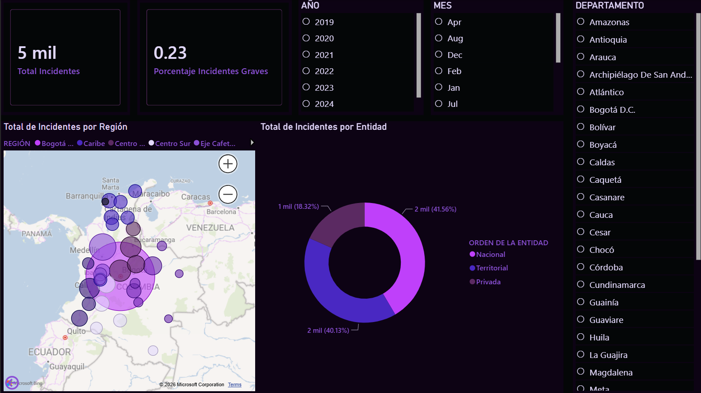
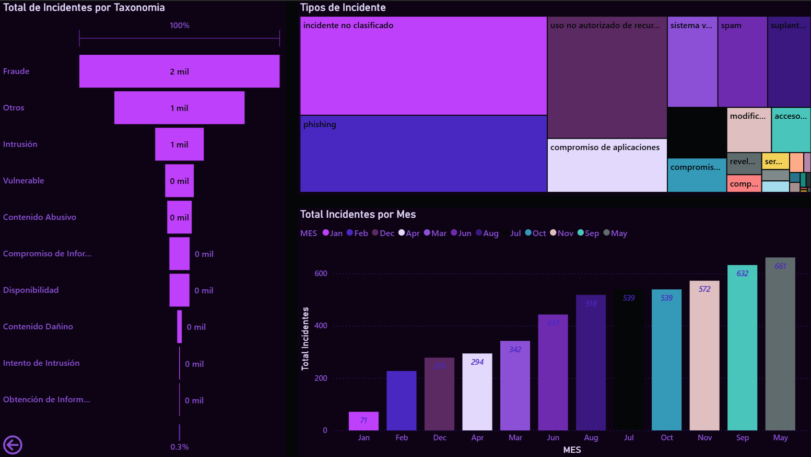
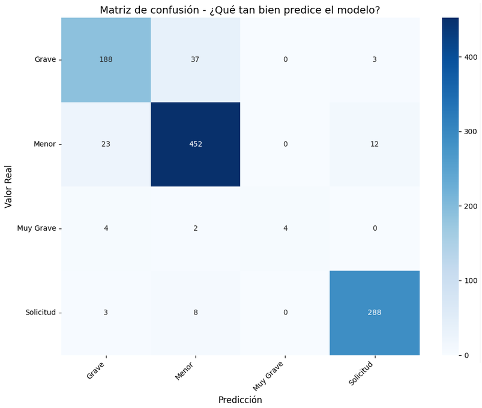
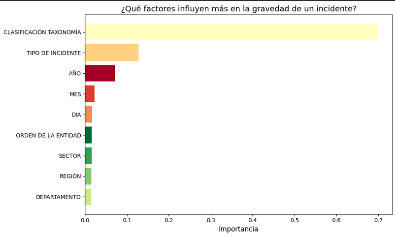
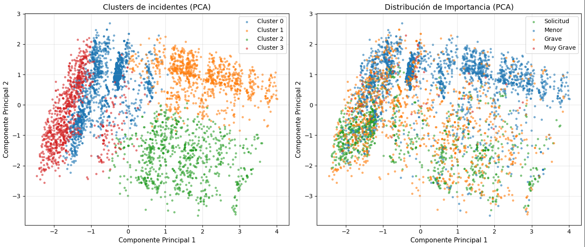

# Incidentes de ciberseguridad en Colombia (2019–2025)

Análisis de los incidentes de ciberseguridad reportados por entidades públicas y privadas en Colombia, desde los datos crudos hasta un tablero en Power BI y modelos de machine learning.

**Preguntas que guían el proyecto:**
- ¿Dónde se concentran los incidentes y qué tipos son más frecuentes?
- ¿Cómo han evolucionado en el tiempo?
- ¿Se puede predecir la gravedad de un incidente a partir de sus características?



---

## Fuente de datos

Portal de Datos Abiertos de Colombia: https://www.datos.gov.co/

El dataset original tiene 5.227 registros con fecha de solicitud, orden de la entidad (nacional, territorial, privada), sector, región, departamento, clasificación según taxonomía, tipo de incidente e importancia (Menor, Solicitud, Grave, Muy Grave).

## Herramientas

- **Python:** pandas, Plotly, scikit-learn, XGBoost, Matplotlib, Seaborn
- **Power BI:** modelado y tablero interactivo
- **Google Colab:** ejecución de los notebooks

## Estructura del repositorio

```
incidentes-ciberseguridad-colombia/
├── README.md
├── img/
│   ├── img1.png                  
│   └── img 2.png            
├── limpieza_datos.ipynb
├── analisis_y_modelos.ipynb
├── dashboard/
│   ├── criminalidad-colombia-dashboard.pbix
```

### 1. Limpieza de datos (`limpieza_datos.ipynb`)

| Paso | Resultado |
|---|---|
| Detección de nulos | 6 nulos en `CLASIFICACIÓN TAXONOMÍA`, `TIPO DE INCIDENTE` e `IMPORTANCIA` → 2 filas eliminadas |
| Inconsistencias de texto | Valores duplicados por mayúsculas (ej. *Minas y Energía* vs. *Minas Y Energía*) en `SECTOR` y `TIPO DE INCIDENTE` → normalizados |
| Registros con error | 3 filas con celdas que empezaban por "error" → eliminadas |
| Transformación de fechas | `FECHA DE SOLICITUD` separada en `DIA`, `MES` y `AÑO` |
| Filtro temporal | Se excluyó 2026 (año incompleto) → 106 filas |
| **Total** | **5.227 → 5.116 registros limpios** |

### 2. Análisis exploratorio (`analisis_y_modelos.ipynb`)

- Nuevas variables: `IMPORTANCIA_BINARIA` (Grave + Muy Grave = Importante) y `REGION_IMPORTANCIA`.
- Gráficos interactivos con Plotly: incidentes por región, top de departamentos, tipos de incidente, evolución mensual y proporción por importancia.

### 3. Tablero en Power BI

KPIs de total de incidentes y porcentaje de graves, mapa por región, distribución por orden de la entidad, embudo por taxonomía, treemap de tipos de incidente y tendencia mensual, con filtros por año, mes y departamento.

### 4. Modelos de machine learning

- **Clasificación de la gravedad:** Random Forest vs. XGBoost para predecir `IMPORTANCIA` (4 clases).
- **Segmentación:** K-Means con 4 clusters y PCA para visualizarlos en 2D.

## Resultados

**Hallazgos del análisis**
- **Bogotá D.C. concentra el 61,8 % de los incidentes** (3.161 de 5.116). Le siguen Centro Oriental (9,5 %) y Eje Cafetero (8,5 %).
- **El 23,3 % de los incidentes son graves o muy graves** (1.190 casos).
- **Fraude** es la taxonomía más frecuente y **phishing** el tipo de ataque identificado más común.
- El tipo más reportado es **"incidente no clasificado"**, lo que señala un problema de calidad en el registro de la fuente.
- Tipos como el **uso no autorizado de recursos** muestran tendencia creciente.

**Modelo de clasificación (XGBoost, conjunto de prueba de 1.024 registros)**

| Clase | Precision | Recall | F1 | Casos |
|---|---|---|---|---|
| Grave | 0,86 | 0,82 | 0,84 | 228 |
| Menor | 0,91 | 0,93 | 0,92 | 487 |
| Muy Grave | 1,00 | **0,40** | 0,57 | 10 |
| Solicitud | 0,95 | 0,96 | 0,96 | 299 |
| **Accuracy** | | | **0,91** | |

XGBoost superó a Random Forest (91,0 % vs. 89,8 % de accuracy). La variable más influyente fue `CLASIFICACIÓN TAXONOMÍA` (importancia de 0,70), seguida de `TIPO DE INCIDENTE` (0,13).

**Segmentación (K-Means):** se identificaron perfiles como un cluster de phishing en el sector privado de Bogotá (2.149 casos) y otro de uso no autorizado de recursos en Centro Oriental, con predominio de incidentes menores.

## Capturas

| Vista general | Detalle por tipo y mes |
|---|---|
|  |  |






## Limitaciones y próximos pasos

- La clase **Muy Grave** tiene solo 49 registros (1 %), por eso el modelo detecta apenas 4 de cada 10. Probaría balanceo de clases (`class_weight`, SMOTE) y evaluaría con F1 macro en lugar de accuracy.
- La alta importancia de la taxonomía sugiere revisar si la gravedad se asigna directamente a partir de ella en la fuente, lo que inflaría el desempeño del modelo.
- Automatizar el flujo para que el notebook de limpieza genere el archivo que lee Power BI sin pasos manuales.


## Autora

**Valentina Cano Meneses** · [GitHub](https://github.com/srtaCano) · [LinkedIn](www.linkedin.com/in/valentina-cano-meneses)
